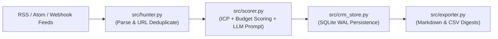

# AI Lead Generation & SQLite CRM Pipeline (RSS Collector + ICP Scorer)

[](https://github.com/agenciaiaonline-wq/ai-lead-gen-crm-pipeline/actions/workflows/ci.yml)
[](src/cli.py)
[](src/crm_store.py)
[](LICENSE)

> **Automated multi-source opportunity hunter, Ideal Customer Profile (ICP) scorer, deduplicated SQLite WAL CRM, and Markdown/CSV digest exporter for AI agencies and B2B sales teams.**

Inspired by open-source AI lead generation pipelines (`LeadGenAI`, `ai-lead-generator`), this repository separates deterministic signal ingestion, explainable ICP budget scoring, WAL-mode CRM deduplication, and daily founder outreach digests—running cleanly with zero paid SaaS dependencies.

---

## Pipeline Architecture



---

## Core Modules

| Module | Responsibility |
| :--- | :--- |
| [`src/hunter.py`](src/hunter.py) | RSS 2.0 / Atom XML ingestion and URL normalization/deduplication |
| [`src/scorer.py`](src/scorer.py) | 0-100 B2B ICP fit + budget detector (`HOT`/`WARM`/`COLD`) + LLM prompt builder |
| [`src/crm_store.py`](src/crm_store.py) | SQLite `WAL` CRM database with unique-URL `INSERT OR IGNORE` idempotency |
| [`src/exporter.py`](src/exporter.py) | Clean Markdown table and CSV spreadsheet exporters for Slack/WhatsApp/CRM sync |
| [`src/cli.py`](src/cli.py) | CLI runner executing end-to-end ingestion -> scoring -> digest |

---

## Quick Start

```bash
# Run end-to-end sample feed pipeline (requires only Python 3.11+ stdlib)
python3 -m src.cli --feed-file examples/sample_feed.xml --db-path ./data/leads.db --min-score 65

# Run automated unit tests
python3 -m unittest discover -s tests -v
```

---

## Custom Lead Engine & CRM Deployment (`USD 3,500 - 9,500`)
- **LinkedIn Studio:** [Golden Nodalix Studio](https://www.linkedin.com/in/agency-golden-nodalix-880598438/)
- **Profile Hub:** [agenciaiaonline-wq](https://github.com/agenciaiaonline-wq)
- **Email:** `studio@example.com`
